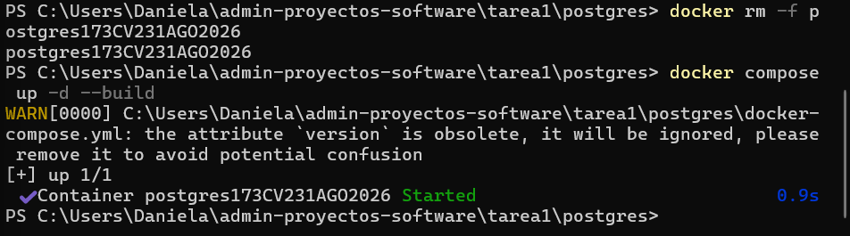
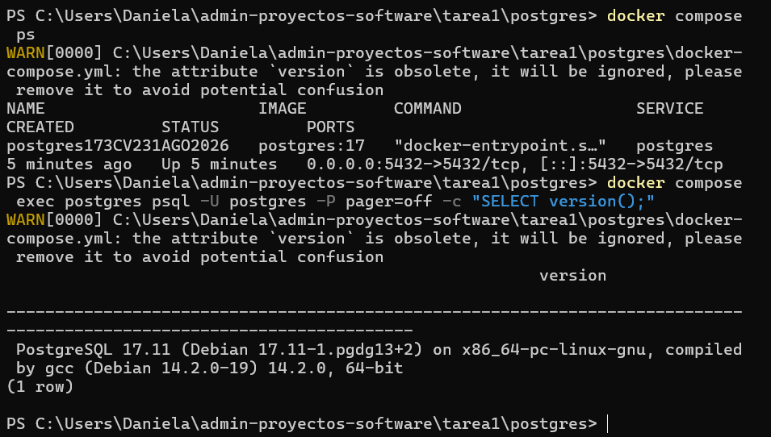
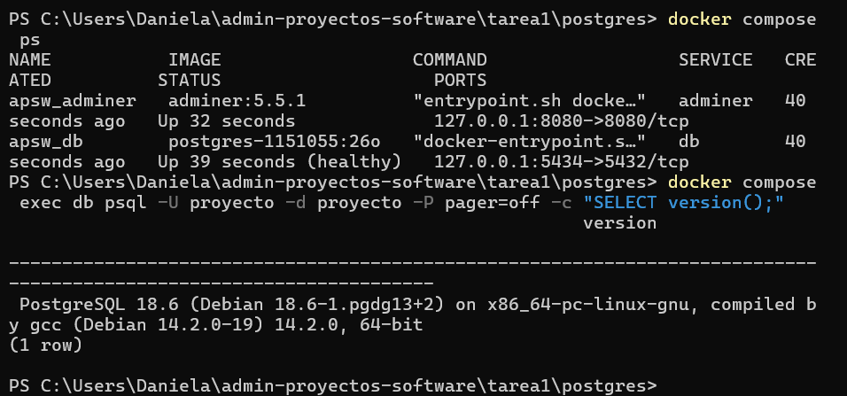
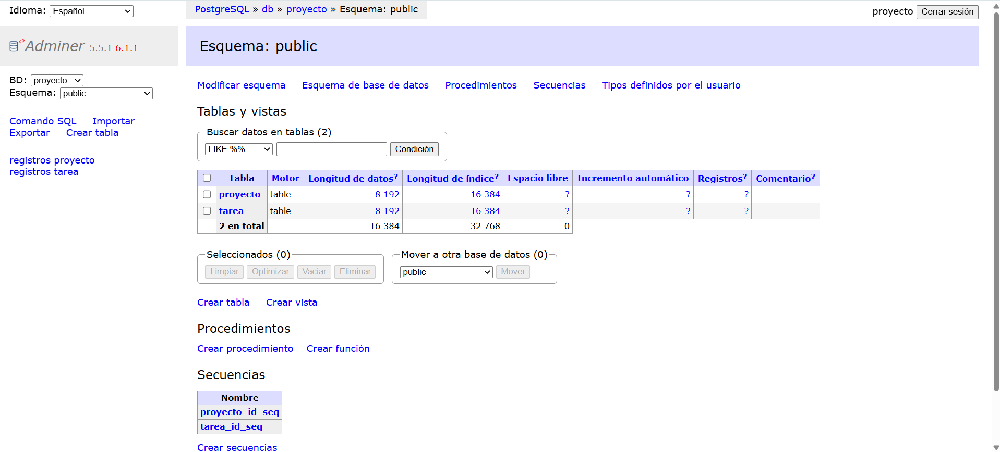
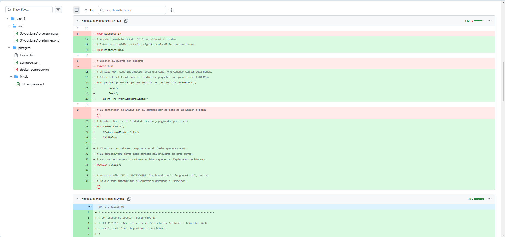
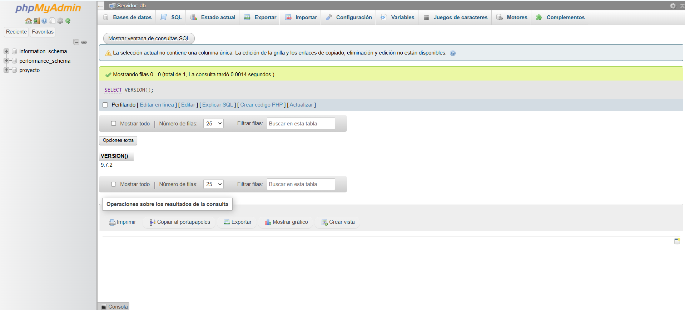
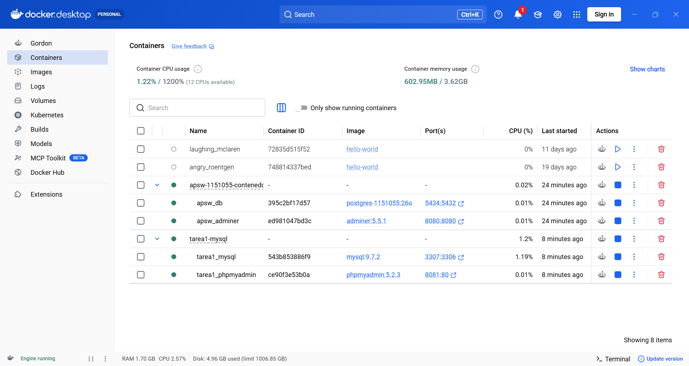
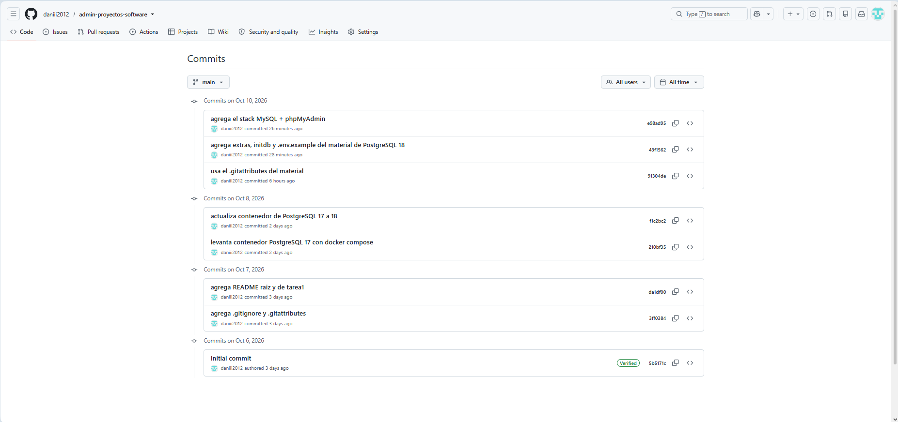

# Tarea 1: administración de proyectos y entorno de trabajo

**Universidad Autónoma Metropolitana**

**Unidad Azcapotzalco**

División de Ciencias Básicas e Ingeniería

Departamento de Sistemas

| | | | |
|:--|:--|:--|:--|
| **UEA y clave** | Administración de Proyectos de Software (1151055) | **Trimestre** | 26-O, otoño 2026 |
| **Licenciatura** | Ingeniería en Computación | **Fecha** | 10 de octubre de 2026 |
| **Nombre** | Daniela Nava Martínez | **Matrícula** | 2223028762 |
| **Profesor** | M. en C. Gabriel Hurtado Avilés | | |

---

## Declaración de uso de IA

Usé inteligencia artificial para la redacción del texto de este documento y, al principio, para crear algunos archivos (un .gitattributes, el esquema de prueba de PostgreSQL y un compose.yaml de MySQL), porque en ese momento no teníamos acceso a la GUIA.md del material. Cuando la obtuve, reemplacé esos archivos por los del material del profesor.

## Introducción

Esta tarea reúne el trabajo de la primera unidad de la UEA: entender qué es un proyecto de software y con qué marcos y herramientas se administra, y preparar el entorno que se usará en el resto del curso. Para ello creé un repositorio propio en GitHub, investigué cuatro temas (proyecto, administración, herramientas y licencias) y levanté dos stacks con Docker Compose: PostgreSQL con Adminer, que actualicé de la versión 17 a la 18, y MySQL con phpMyAdmin. Cada avance quedó registrado con confirmaciones de Git en días distintos.

## Objetivo

Investigar qué es un proyecto de software, con qué marcos y herramientas se administra y bajo qué licencias se distribuye, y comenzar a usar Git para registrar cada cambio: actualizar un contenedor de PostgreSQL 17 a 18 y montar un segundo stack con MySQL y phpMyAdmin.

## Contenido

- [Ejercicio 1 · El repositorio](#ejercicio-1--el-repositorio)
- [Ejercicio 2 · Investigación](#ejercicio-2--investigación)
- [Ejercicio 3 · De PostgreSQL 17 a 18](#ejercicio-3--de-postgresql-17-a-18)
- [Ejercicio 4 · MySQL + phpMyAdmin](#ejercicio-4--mysql--phpmyadmin)
- [Ejercicio 5 · Capturas](#ejercicio-5--capturas)
- [Conclusiones](#conclusiones)
- [Referencias](#referencias)

---

## Ejercicio 1 · El repositorio

Así dejé listo el repositorio, en el orden en que lo hice:

1. Creé en GitHub el repositorio público [admin-proyectos-software](https://github.com/daniii2012/admin-proyectos-software) y elegí la licencia MIT al crearlo; de ahí salió el archivo [LICENSE](../LICENSE).
2. Escribí el [.gitignore](../.gitignore) con cuatro entradas (data/, .env, Thumbs.db y .DS_Store) y lo subí antes de levantar cualquier contenedor, para que la carpeta data/ de PostgreSQL 17 no entrara a Git.
3. Armé primero un [.gitattributes](../.gitattributes) propio y después lo reemplacé por el del material. Sirve para que los scripts y archivos de configuración guardados en Windows no fallen al leerse dentro de un contenedor Linux.
4. Hice confirmaciones en cinco días distintos, del 6 al 10 de octubre de 2026, con mensajes que dicen qué se hizo. El historial se ve en la captura 8.
5. Dejé un [README](../README.md) en la raíz con la liga a esta tarea; este documento es el README de la carpeta tarea1.

---

## Ejercicio 2 · Investigación

### 1. ¿Qué es un proyecto de software?

**Proyecto frente a operación continua.** Un proyecto es un esfuerzo temporal que se emprende para crear un producto, servicio o resultado único; tiene un inicio y un fin definidos, y su alcance se detalla progresivamente conforme el equipo aprende (Project Management Institute [PMI], 2017). La operación continua, en cambio, es trabajo repetitivo y permanente que mantiene disponible un producto o servicio ya existente, y se mide por eficiencia y disponibilidad, no por cumplir un objetivo único (PMI, 2021). En este curso el proyecto es el trimestre completo; el mantenimiento posterior del producto sería operación continua.

**Proyecto, producto y proceso.** Son tres conceptos distintos (PMI, 2017):

| | Proyecto | Producto | Proceso |
|:--|:--|:--|:--|
| **Qué es** | Esfuerzo temporal con objetivo, equipo y fechas | Lo que se entrega y se usa: el software, su documentación y su operación | La forma repetible de trabajar: cómo se planea, construye, revisa y libera |
| **Cuánto dura** | Termina cuando cumple su objetivo o se cancela | Sobrevive al proyecto que lo creó | Se mejora de un proyecto a otro |

Confundirlos lleva a medir mal: un proyecto puede cerrar a tiempo con un producto que nadie usa.

**Alcance, tiempo, costo y calidad.** Son las restricciones clásicas y se equilibran entre sí: el alcance define qué se entrega y qué no; el tiempo, las fechas y dependencias; el costo, el esfuerzo de las personas y la infraestructura; y la calidad, el grado en que el producto cumple sus requisitos (PMI, 2021). Mover una presiona a las demás; por ejemplo, ampliar el alcance sin mover la fecha exige más esfuerzo o compromete la calidad.

### 2. ¿Cómo se administra?

**La Guía del PMBOK®.** Es el cuerpo de conocimiento y estándar del PMI. La 6.ª edición organiza la dirección de proyectos en cinco grupos de procesos (inicio, planificación, ejecución, monitoreo y control, cierre) y diez áreas de conocimiento (PMI, 2017). La 7.ª edición deja de prescribir procesos y propone doce principios y ocho dominios de desempeño que describen resultados (PMI, 2021).

**Scrum.** Es un marco ágil ligero para generar valor con soluciones adaptativas a problemas complejos. Reparte el trabajo entre tres responsabilidades (Product Owner, Scrum Master y Developers) y lo organiza en ciclos cortos llamados Sprints, que incluyen una planeación, un seguimiento diario, una revisión del resultado con los interesados y una retrospectiva del equipo. Sus tres artefactos son el Product Backlog, el Sprint Backlog y el Incremento (Schwaber y Sutherland, 2020).

**Modelos predictivo, iterativo y ágil.** El modelo predictivo organiza el trabajo en fases secuenciales (requisitos, diseño, implementación, pruebas y operación) y supone requisitos estables; Royce (1970) advirtió que dejar las pruebas al final vuelve costoso corregir. El modelo iterativo repite ciclos cortos para refinar el producto con retroalimentación; un ejemplo es la espiral de Boehm (1988), guiada por riesgos. El enfoque ágil, formalizado en el Manifiesto Ágil, prioriza el software funcionando y la respuesta al cambio sobre seguir un plan rígido (Beck et al., 2001).

**Cuál elegiría para un proyecto como el del curso.** Elegiría un enfoque ágil con Scrum: los requisitos no están completamente definidos al inicio, hay entregas periódicas que el profesor revisa y el equipo aprende herramientas nuevas (Docker, Git, GitHub) sobre la marcha, lo que encaja mejor con ciclos cortos de retroalimentación que con fases secuenciales.

### 3. ¿Con qué herramientas?

**Control de versiones, tableros, contenedores e integración continua.** El control de versiones (Git) registra el historial de cambios en tres áreas (directorio de trabajo, área de preparación y repositorio local) y lo sincroniza con un remoto con push y pull (Chacon y Straub, 2014). Los tableros (GitHub Projects) organizan las tareas, normalmente registradas como issues, y dan trazabilidad (GitHub, 2026). Los contenedores empaquetan una aplicación con sus dependencias en una imagen que se ejecuta igual en cualquier máquina (Docker Inc., 2026). La integración continua ejecuta pruebas y análisis automáticamente en cada cambio propuesto, por ejemplo con GitHub Actions (GitHub, 2026).

**Docker frente a una máquina virtual.** Ambos aíslan un entorno, pero a distinto costo. Una máquina virtual emula un equipo completo con su propio sistema operativo: arranca en minutos y ocupa gigabytes. Un contenedor comparte el núcleo del sistema anfitrión y empaqueta solo la aplicación y sus dependencias: arranca en segundos y pesa mucho menos (Docker Inc., 2026).

**Dockerfile frente a compose.yaml.** Un Dockerfile es la receta para construir una imagen propia (instrucciones como FROM, RUN, ENV y WORKDIR) y se ejecuta al construirla. Un compose.yaml describe un sistema de varios servicios (por ejemplo, una base de datos y su interfaz web) con su imagen, puertos, variables de entorno y volúmenes, y los levanta con un solo comando (Docker Inc., 2026).

**El volumen.** Es el mecanismo de Docker para guardar datos fuera del contenedor. Como los contenedores son desechables, lo que se escribe dentro se pierde al borrarlos; un volumen con nombre sobrevive a docker compose down y solo se elimina con docker compose down -v (Docker Inc., 2026).

**Comandos de Docker Compose:**

| Comando | Qué hace |
|---|---|
| up -d | Levanta todos los servicios en segundo plano |
| exec | Ejecuta un comando dentro de un contenedor que ya corre (por ejemplo, docker compose exec db bash) |
| stop | Detiene los contenedores sin eliminarlos |
| down | Elimina los contenedores y la red, y conserva los volúmenes (down -v también los borra) |
| ps | Muestra el estado de cada servicio |
| logs | Muestra la salida de un servicio; casi todos los fallos se explican ahí |

### 4. ¿Bajo qué licencia se distribuye el software?

Toda obra de software está protegida por derechos de autor desde su creación. Una licencia de código abierto es el documento con el que quien la posee autoriza a otros a usarla, modificarla y redistribuirla, y bajo qué condiciones (Open Source Initiative, s. f.).

**a) Los dos grandes tipos**

| | Permisiva (MIT, BSD, Apache 2.0) | Copyleft (GPL, LGPL, AGPL) |
|---|---|---|
| **Qué permite** | Usar, copiar, modificar, vender y redistribuir el código, incluso dentro de software propietario cerrado | Usar, copiar, modificar y redistribuir el código, incluso con fines comerciales |
| **Qué exige** | Conservar el aviso de copyright y el texto de la licencia | Que las obras derivadas se distribuyan bajo la misma licencia y con su código fuente. LGPL lo relaja para bibliotecas enlazadas; AGPL lo extiende al software ofrecido como servicio por red |
| **Con software propietario** | Compatible: se puede incorporar a un producto cerrado | Poco o nada compatible: obliga a liberar también el código que lo usa |
| **Ejemplos** | React, la mayoría de los paquetes de npm | Linux, MariaDB |

(Open Source Initiative, s. f.; Free Software Foundation, s. f.)

**b) Mi elección: MIT.** Este repositorio usa MIT porque es un trabajo académico que no necesita restringir cómo se reutiliza el código, y porque MIT es corta y simple. Su ventaja principal frente a la GPL es la compatibilidad: cualquiera puede tomar el código, modificarlo y usarlo, incluso en software propietario, sin liberar su propio trabajo. Si hubiera elegido GPL, cualquier proyecto que incorporara este código tendría que distribuirse también bajo GPL y con su código fuente, lo que limitaría su reutilización.

**c) Caso real: de MySQL a MariaDB.** MySQL AB fue adquirida por Sun Microsystems en 2008, y Oracle compró Sun en 2009 (operación cerrada en enero de 2010) (Wikipedia, 2026). Michael «Monty» Widenius, cofundador de MySQL, creó entonces MariaDB como una bifurcación (*fork*) del código de MySQL, por la preocupación de que Oracle controlara el rumbo del proyecto (Wikipedia, 2026). MySQL se distribuía con doble licencia: GPL, y una licencia comercial para quien no quisiera las obligaciones del copyleft.

La clave es la licencia: como MySQL estaba bajo GPL, su código fuente era público y cualquiera tenía el derecho legal de tomarlo, modificarlo y redistribuirlo bajo las mismas condiciones, sin pedirle permiso a Oracle. Eso fue exactamente lo que hizo Widenius, y usuarios y distribuciones de Linux pudieron migrar a MariaDB como alternativa compatible. Con una licencia propietaria el fork no habría sido legal.

---

## Ejercicio 3 · De PostgreSQL 17 a 18

Los archivos están en [postgres/](postgres/). Primero levanté el contenedor del 22 de septiembre (PostgreSQL 17) y después lo reemplacé por el nuevo (PostgreSQL 18).

### PostgreSQL 17

### PostgreSQL 18

### Confirmaciones de esta parte

El trabajo está en tarea1/postgres/ y quedó en tres confirmaciones, en este orden:

1. **Levanta contenedor PostgreSQL 17 con docker compose.** El Dockerfile y el docker-compose.yml del 22 de septiembre, sin cambios.
2. **Actualiza contenedor de PostgreSQL 17 a 18.** Apagué la 17 con docker compose down, borré el docker-compose.yml y puse el Dockerfile y el compose.yaml nuevos.
3. **Agrega extras, initdb y .env.example del material de PostgreSQL 18.** Con el material completo de la guía, el esquema de prueba pasó a ser el del curso (tablas equipo e historia) y se agregó el script comprobar.sh.

### Cómo levantarlo

| Paso | Comando o dirección |
|:--|:--|
| Entrar a la carpeta | cd tarea1/postgres |
| Prender (la primera vez construye la imagen) | docker compose up -d |
| Ver el estado; la base debe decir (healthy) | docker compose ps |
| Ver las tablas con Adminer | http://localhost:8080 (motor PostgreSQL; servidor db; base y usuario proyecto; contraseña practica_local_26o) |
| Comprobar el entorno desde dentro | docker compose exec db bash, y después bash extras/comprobar.sh (debe decir 9 de 9 comprobaciones) |
| Apagar | docker compose stop |

### 3.1 Diferencias entre los dos contenedores

| Qué | Qué decía (17) | Qué dice (18) | Por qué cambió |
|---|---|---|---|
| Nombre del archivo | docker-compose.yml | compose.yaml | compose.yaml es el nombre actual; el anterior viene de cuando Compose era un programa aparte |
| Primera línea | version: '3.8' | No hay | Compose V2 la ignora y avisa que es obsoleta |
| Imagen | image: postgres:17 | build: . con FROM postgres:18.6 | Versión completa fijada, no «latest», y una imagen propia con nano, less y la zona horaria |
| Datos | ./data:/var/lib/postgresql/data | datos_db:/var/lib/postgresql | PostgreSQL 18 cambió el punto de montaje; además un volumen con nombre no ensucia el proyecto ni se sube a Git |
| Contraseña | Escrita en el archivo: postgres | ${POSTGRES_PASSWORD:-...} | No se debe versionar una contraseña; se lee de un .env |
| Puerto | "5432:5432" | "127.0.0.1:5434:5432" | Publica el puerto solo en mi máquina y evita choques con otro PostgreSQL |
| ¿Sabe si está lista? | No | healthcheck | Con (healthy) se sabe que la base ya responde, no solo que el contenedor existe |
| Interfaz web | No | Adminer | Permite ver las tablas sin instalar nada |
| Carpeta del proyecto dentro | No, solo data/ | ./:/trabajo | Permite ejecutar extras/comprobar.sh dentro del contenedor |
| Servicio y usuario | postgres / postgres | db / proyecto | Nombres más claros y un usuario distinto del administrador por defecto |
| Datos de prueba | No | initdb/01_esquema.sql | Crea las tablas equipo e historia la primera vez que arranca |

### 3.2 El Dockerfile viejo

No se usaba. En el archivo viejo el servicio solo traía image: postgres:17 y no tenía la clave build:, así que Compose bajaba la imagen oficial de Docker Hub y nunca abría el Dockerfile. Por eso agregar --build no cambiaba nada: esa opción solo tiene efecto con servicios que declaran build: (Docker Inc., 2026). Además, el Dockerfile viejo solo repetía FROM postgres:17, así que aunque se hubiera usado habría dado la misma imagen.

### 3.3 Versionado semántico

El versionado semántico numera las versiones como MAJOR.MINOR.PATCH: se sube MAJOR cuando hay cambios incompatibles con lo anterior, MINOR cuando se agregan funciones compatibles y PATCH cuando solo se corrigen errores (Preston-Werner, 2013). PostgreSQL no lo sigue al pie de la letra, porque desde la versión 10 usa solo MAJOR.MINOR, pero la idea es la misma (PostgreSQL Global Development Group, s. f.).

Pasar de la 17 a la 18 es un cambio mayor porque cambia el número MAJOR y trae cambios que rompen la compatibilidad con la configuración anterior. En esta práctica se vio con el punto de montaje de los datos: en la 17 era /var/lib/postgresql/data y en la 18 es /var/lib/postgresql, con PGDATA=/var/lib/postgresql/18/docker. Si se monta la ruta vieja con la imagen 18, el contenedor no arranca y el log dice «unused mount/volume». Por eso un salto de versión mayor se revisa y se prueba, mientras que uno menor (por ejemplo de 18.5 a 18.6) se puede aplicar sin cambiar la configuración.

---

## Ejercicio 4 · MySQL + phpMyAdmin

El archivo está en [mysql/compose.yaml](mysql/compose.yaml): es la plantilla 3-mysql/ con los 11 huecos llenos con la tabla de equivalencias de la guía.

### Los 11 huecos de la plantilla

Los llené en el orden en que aparecen en el archivo, tomando los valores de la tabla de equivalencias de la guía:

1. Imagen de la base: mysql:9.7.2, la versión LTS con su número completo.
2. Contraseña del administrador: MYSQL_ROOT_PASSWORD, obligatoria.
3. Base que se crea al iniciar: MYSQL_DATABASE.
4. Usuario normal: MYSQL_USER.
5. Contraseña de ese usuario: MYSQL_PASSWORD.
6. Puerto interno de MySQL: 3306, el de la derecha en ports.
7. Carpeta de datos: /var/lib/mysql, donde MySQL guarda la información dentro del volumen.
8. Imagen de phpMyAdmin: phpmyadmin:5.2.3.
9. Puerto interno de phpMyAdmin: 80.
10. Servidor al que se conecta: db, que es el nombre del servicio y no una dirección.
11. Condición de espera: service_healthy, para que phpMyAdmin arranque cuando la base ya está sana.

### Cómo levantarlo

| Paso | Comando o dirección |
|:--|:--|
| Entrar a la carpeta | cd tarea1/mysql |
| Prender | docker compose up -d |
| Ver el estado; la base debe decir (healthy) | docker compose ps |
| Entrar a phpMyAdmin | http://localhost:8081 con usuario proyecto y contraseña practica_local_26o |
| Apagar | docker compose stop |

### 4.1 Comparación de los dos stacks

| Concepto | PostgreSQL + Adminer | MySQL + phpMyAdmin |
|---|---|---|
| Imagen de la base | postgres:18.6 (con Dockerfile propio) | mysql:9.7.2 (sin Dockerfile) |
| Imagen web | adminer:5.5.1 | phpmyadmin:5.2.3 |
| Contraseña del administrador | POSTGRES_PASSWORD | MYSQL_ROOT_PASSWORD |
| Base | POSTGRES_DB | MYSQL_DATABASE |
| Usuario | POSTGRES_USER | MYSQL_USER |
| Contraseña del usuario | POSTGRES_PASSWORD | MYSQL_PASSWORD |
| Puerto interno | 5432 | 3306 |
| Puerto publicado | 127.0.0.1:5434 | 127.0.0.1:3307 |
| Carpeta de datos | /var/lib/postgresql | /var/lib/mysql |
| Puerto web (interno) | 8080 | 80 (publicado en 8081) |
| Servidor de la interfaz web | ADMINER_DEFAULT_SERVER: db | PMA_HOST: db |
| Comprobación de salud | pg_isready | mysqladmin ping |
| Volumen | datos_db | datos_mysql |

En los dos casos el patrón es el mismo: una base con volumen y healthcheck, y una interfaz web que espera a que la base esté sana (condition: service_healthy).

### 4.2 Versiones LTS e innovation

MySQL publica dos tipos de versiones. Una versión **LTS** (*long-term support*) recibe correcciones y parches de seguridad durante varios años, y es la adecuada para sistemas que deben mantenerse estables. Una versión **innovation** trae funciones nuevas con rapidez, pero su soporte es corto y se reemplaza pronto por la siguiente.

Elegí la imagen mysql:9.7.2 en lugar de mysql:latest por dos razones. La primera es que latest significa «la última que subieron», no «la estable»: según la guía del curso, hoy apunta a la 26.7.0, que es una versión innovation de soporte corto, mientras que la 9.7.2 es la LTS (Hurtado Avilés, 2026). La segunda es que latest cambia sin avisar, así que el mismo compose.yaml podría levantar versiones distintas en dos equipos o en dos fechas. Fijar el número completo hace que el entorno sea reproducible (Docker Inc., 2026).

---

## Ejercicio 5 · Capturas

Las ocho capturas están en la carpeta img/.

### Captura 1 · PostgreSQL 17 levantado

Se levanta el contenedor con docker compose up -d --build y aparece el aviso de que la clave version ya es obsoleta.

### Captura 2 · Versión de PostgreSQL 17

El comando ps muestra el contenedor postgres:17 en ejecución y SELECT version(); responde con PostgreSQL 17.11.

### Captura 3 · Versión de PostgreSQL 18

Con la imagen nueva, ps marca la base como healthy y SELECT version(); responde con PostgreSQL 18.6.

### Captura 4 · Adminer con las tablas

Adminer conectado a la base proyecto, donde se ven las tablas equipo, historia y comprobacion.

### Captura 5 · Cambios de la 17 a la 18

El diff de la confirmación en GitHub: FROM postgres:17 se sustituye por FROM postgres:18.6 y aparece el nuevo compose.yaml.

### Captura 6 · phpMyAdmin

phpMyAdmin conectado al servidor db, con la consulta SELECT VERSION(); que devuelve 9.7.2.

### Captura 7 · Los dos stacks en Docker Desktop

Docker Desktop con los dos grupos encendidos: apsw-1151055-contenedor (PostgreSQL y Adminer) y tarea1-mysql (MySQL y phpMyAdmin).

### Captura 8 · Historial de confirmaciones

La lista de confirmaciones del repositorio en GitHub, donde se ve el orden de PostgreSQL 17, PostgreSQL 18 y MySQL.

---

## Conclusiones

- Entendí que proyecto, producto y proceso no son lo mismo: el proyecto termina, pero el producto sigue vivo y el proceso se mejora con cada proyecto.
- Fijar la versión completa de las imágenes (postgres:18.6, mysql:9.7.2) y escribir el entorno en archivos hace que el sistema se levante igual en cualquier computadora.
- Pasar de PostgreSQL 17 a 18 no fue solo cambiar un número: cambió el punto de montaje de los datos, y con la ruta anterior el contenedor no arranca.
- El volumen con nombre y el healthcheck resolvieron dos problemas reales: que los datos sobrevivan al borrar el contenedor y saber cuándo la base ya responde.
- Durante la práctica me encontré con dos errores: un contenedor viejo con el mismo nombre que ya estaba en uso, y descargas de imágenes que se cortaron. Los resolví borrando el contenedor anterior y repitiendo la descarga.
- La licencia decide qué puede hacer cualquiera con un programa. El caso de MySQL y MariaDB muestra que una licencia libre permite que la comunidad continúe un proyecto aunque la empresa dueña cambie de rumbo.

---

## Referencias

Beck, K., Beedle, M., van Bennekum, A., Cockburn, A., Cunningham, W., Fowler, M., Grenning, J., Highsmith, J., Hunt, A., Jeffries, R., Kern, J., Marick, B., Martin, R. C., Mellor, S., Schwaber, K., Sutherland, J., y Thomas, D. (2001). *Manifiesto por el Desarrollo Ágil de Software*. https://agilemanifesto.org/iso/es/manifesto.html

Boehm, B. W. (1988). A spiral model of software development and enhancement. *Computer, 21*(5), 61–72.

Chacon, S., y Straub, B. (2014). *Pro Git* (2.ª ed.). Apress. https://git-scm.com/book/es/v2

Docker Inc. (2026). *Docker Documentation*. https://docs.docker.com

Free Software Foundation. (s. f.). *Licencias*. https://www.gnu.org/licenses/licenses.es.html

GitHub. (2026). *GitHub Docs*. https://docs.github.com

Hurtado Avilés, G. (2026). *Tarea 1 · Guía paso a paso (GUIA.md)*. UAM Azcapotzalco, Departamento de Sistemas.

Open Source Initiative. (s. f.). *Licenses & Standards*. https://opensource.org/licenses

PostgreSQL Global Development Group. (s. f.). *Versioning policy*. https://www.postgresql.org/support/versioning/

Preston-Werner, T. (2013). *Versionado Semántico 2.0.0*. https://semver.org/lang/es/

Project Management Institute. (2017). *A Guide to the Project Management Body of Knowledge (PMBOK® Guide)* (6.ª ed.). PMI.

Project Management Institute. (2021). *A Guide to the Project Management Body of Knowledge (PMBOK® Guide) – Seventh Edition and The Standard for Project Management*. PMI.

Royce, W. W. (1970). Managing the development of large software systems. *Proceedings of IEEE WESCON*, 1–9.

Schwaber, K., y Sutherland, J. (2020). *La Guía de Scrum*. https://scrumguides.org

Wikipedia. (2026). MySQL. En *Wikipedia*. https://en.wikipedia.org/wiki/MySQL
