# Tarea 2: entorno móvil e inteligencia artificial con MCP

| | | | |
|:--|:--|:--|:--|
| **UEA y clave** | Administración de Proyectos de Software (1151055) | **Trimestre** | 26-O, otoño 2026 |
| **Licenciatura** | Ingeniería en Computación | **Fecha** | 17 de octubre de 2026 |
| **Nombre** | Daniela Nava Martínez | **Matrícula** | 2223028762 |
| **Profesor** | M. en C. Gabriel Hurtado Avilés | | |

---

## Declaración de uso de IA

Usé inteligencia artificial para apoyarme en la redacción del texto de este documento, para guiarme paso a paso en la instalación y para resolver los errores que me aparecieron por la versión de Android.

## Resumen

Esta tarea tiene tres partes. En la primera dejé lista mi computadora y mi teléfono Android para correr dos aplicaciones de prueba, una en Flutter y otra en Kotlin Multiplatform. En la segunda investigué qué es el Model Context Protocol (MCP) y en qué se diferencia de una API. En la tercera instalé un servidor MCP de sistema de archivos en Claude Desktop, lo limité a una carpeta de prueba y comprobé cinco operaciones y su límite de seguridad.

**Índice de la investigación (carpeta docs):**

1. [Evolución de los modelos](docs/01-evolucion-de-los-modelos.md)
2. [El problema del aislamiento](docs/02-problema-del-aislamiento.md)
3. [MCP frente a una API](docs/03-mcp-frente-a-api.md)
4. [Arquitectura](docs/04-arquitectura.md)
5. [El servidor de sistema de archivos](docs/05-servidor-de-sistema-de-archivos.md)
6. [Seguridad](docs/06-seguridad.md)
7. [Casos de uso](docs/07-casos-de-uso.md)

La configuración de MCP está en [config](config/claude_desktop_config.json) y las capturas en [img](img/). Las diapositivas de la exposición están en [presentacion](presentacion/presentacion_mcp.pptx).

---

## Parte 1. El entorno de desarrollo móvil

Cloné los repositorios [Flutter-Projects](https://github.com/gabrielhuav/Flutter-Projects) (carpeta HolaMundoFlutter) y [HolaMundoKMP](https://github.com/gabrielhuav/HolaMundoKMP) fuera de este repositorio y seguí sus README. Usé un teléfono Android físico, no un emulador.

### Lo que instalé

| Componente | Versión |
|:--|:--|
| Sistema operativo | Windows 11 Home Single Language, 64 bits (25H2) |
| Android Studio | Rabbit 1 \| 2026.2.1 |
| Flutter | 3.47.6 (canal stable) |
| Dart | 3.13.5 |
| SDK de Android | 36.1.0 |
| NDK | 28.2.13676358 (lo instalé desde el SDK Manager) |
| Dispositivo | Samsung Galaxy A54 (modelo SM-A546E) |
| Versión de Android del dispositivo | Android 16 (API 36) |

### Capturas

**1. Android Studio con las Command-line Tools.** En el SDK Manager, pestaña SDK Tools, las Android SDK Command-line Tools aparecen marcadas e instaladas.

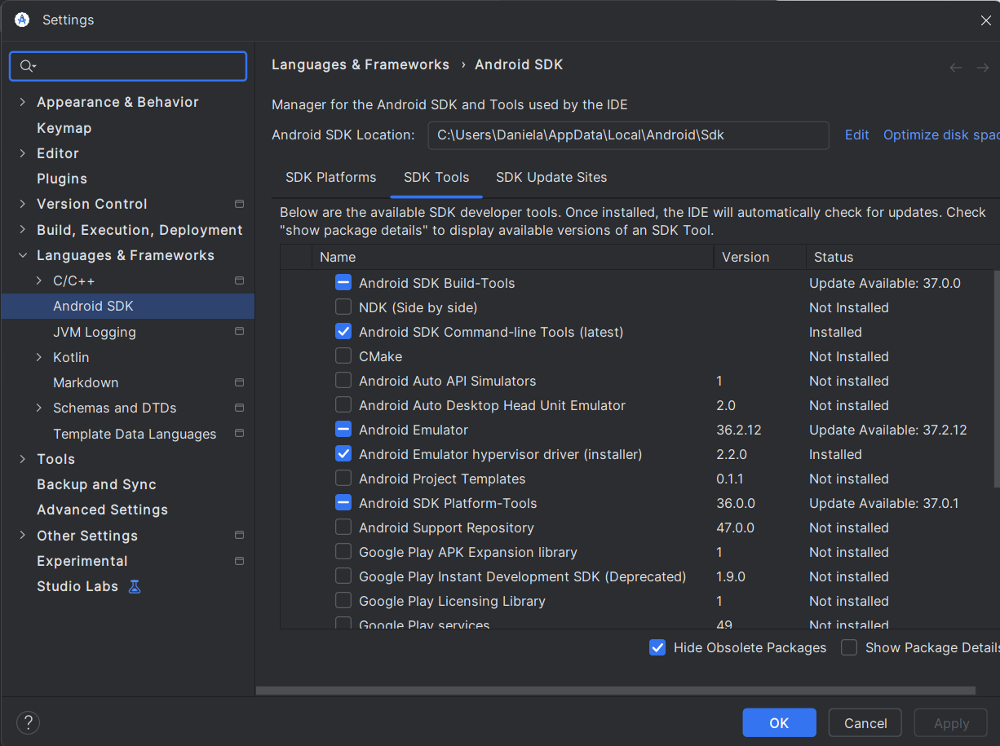

**2. Versiones de Flutter y de Dart.** El comando flutter --version muestra Flutter 3.47.6 y Dart 3.13.5.

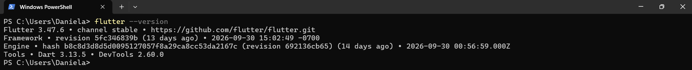

**3. Diagnóstico de Flutter.** En flutter doctor, Flutter y Android toolchain aparecen con la marca de correcto. La línea de Visual Studio marca error porque es para aplicaciones de escritorio de Windows y este proyecto no las usa.

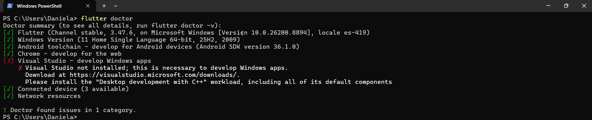

**4. Modo desarrollador del teléfono.** Las opciones de desarrollador y la depuración por USB están activadas, y el teléfono aparece en la lista de dispositivos de Flutter. Taparé o recorté el número de serie del dispositivo.

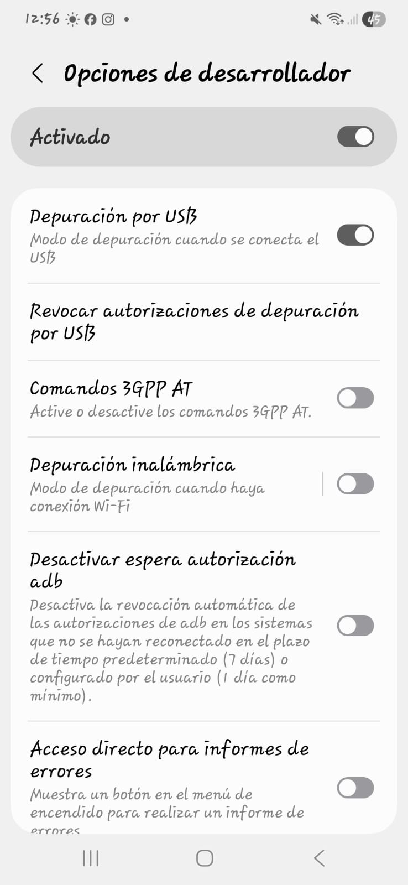

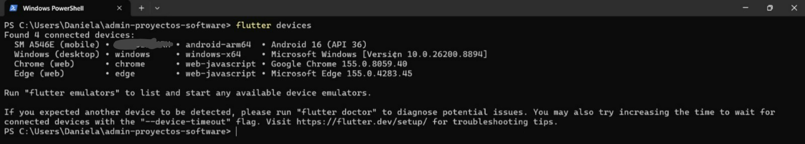

**5. HolaMundoFlutter en el teléfono.** La aplicación muestra el saludo "¡Hola desde Android!" y el contador de toques.

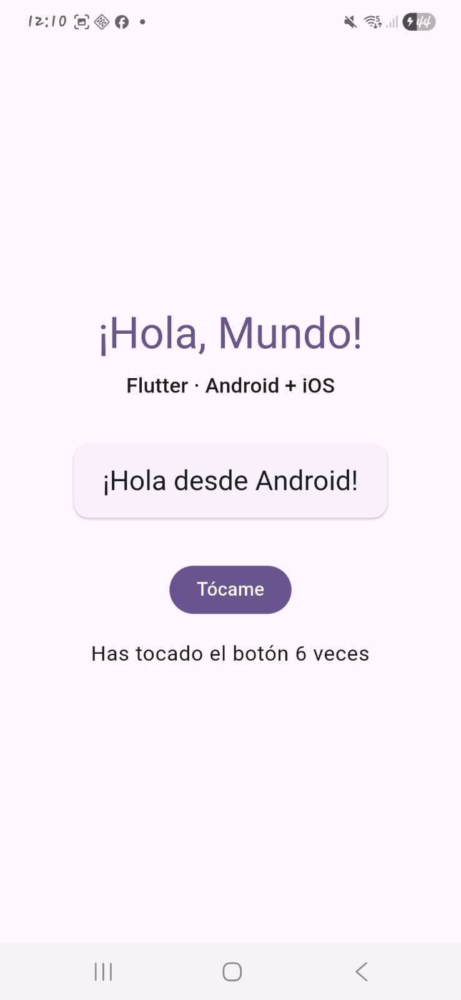

**6. HolaMundoKMP en el teléfono.** La aplicación muestra "¡Hola Mundo!" con Compose Multiplatform, ejecutada desde Android Studio.


### Problemas que encontré

| Problema | Cómo lo resolví |
|:--|:--|
| Al compilar HolaMundoFlutter, Gradle no encontró el NDK 28.2.13676358 y la compilación falló | Instalé esa versión del NDK desde el SDK Manager de Android Studio (SDK Tools, Show Package Details) y volví a ejecutar |
| El teléfono aparecía como no autorizado y Flutter no lo detectaba | Cambié el cable y revoqué las autorizaciones de depuración por USB, para que el teléfono volviera a pedir el permiso |
| La sincronización de Gradle de HolaMundoKMP falló por una versión incompatible del plugin de Android | Actualicé Android Studio |

---

## Parte 2. MCP: investigación

La investigación está en la carpeta [docs](docs/), con un archivo por tema. La especificación que consulté es la revisión 2026-07-28 de Model Context Protocol, el 17 de octubre de 2026.

### MCP frente a una API

| Aspecto | API | MCP |
|:--|:--|:--|
| Quién decide qué se invoca | El programador, al escribir el código | El modelo, en el momento, según la conversación |
| Cómo se descubren las capacidades | Se leen en la documentación antes de programar | El cliente le pide al servidor su catálogo de herramientas |
| Acoplamiento | Alto: la aplicación queda escrita para esa API | Bajo: el cliente funciona con cualquier servidor que hable el protocolo |
| Formato de los mensajes | Cada API define el suyo | Uno común: JSON-RPC 2.0 |
| Autenticación y consentimiento | Cada API tiene la suya y el consentimiento depende de la aplicación | La especificación exige el consentimiento del usuario antes de invocar una herramienta |
| Reutilización entre aplicaciones | Se reescribe la integración en cada aplicación | Un mismo servidor sirve a todos los clientes compatibles |

MCP no sustituye a las APIs: casi siempre envuelve una que ya existe y le agrega una capa común para que un modelo la descubra y la use.

---

## Parte 3. MCP: implementación

### Cliente elegido

Elegí Claude Desktop porque es la aplicación con la que la documentación oficial de MCP explica cómo conectar servidores locales, porque la configuración se hace en un solo archivo y porque ya tenía una cuenta para usarla.

### Instalación paso a paso

**Entorno en que lo instalé:**

| Componente | Versión |
|:--|:--|
| Sistema operativo | Windows 11 Home Single Language, 64 bits (25H2) |
| Node.js | v20.19.5 |
| npx | 10.8.2 |
| Claude Desktop | 2.42304.0 |
| Servidor | @modelcontextprotocol/server-filesystem, la versión más reciente disponible el 17 de octubre de 2026 |

**Pasos:**

1. Verifiqué que Node.js estuviera instalado con los comandos node --version y npx --version.
2. Creé una carpeta solo para la tarea, C:\Users\Daniela\mcp-tarea2, y dentro puse dos archivos de prueba, notas.txt y proyecto.md. Fuera de ella creé un tercero, fuera-de-la-carpeta.txt, para probar el límite.
3. Probé que el servidor arrancara solo, con el comando npx -y @modelcontextprotocol/server-filesystem C:\Users\Daniela\mcp-tarea2. Respondió que estaba corriendo y esperando mensajes por stdio.
4. Instalé Claude Desktop y entré a Configuración, sección Desarrollador, con el botón Editar configuración.
5. Agregué el bloque del servidor al archivo claude_desktop_config.json. Su contenido, sin credenciales, es:

```json
{
  "mcpServers": {
    "filesystem": {
      "command": "cmd",
      "args": [
        "/c",
        "npx",
        "-y",
        "@modelcontextprotocol/server-filesystem",
        "C:\\Users\\Daniela\\mcp-tarea2"
      ]
    }
  }
}
```

6. Cerré Claude Desktop por completo, también desde la bandeja del sistema, y lo abrí de nuevo.
7. Verifiqué en la misma sección que el servidor filesystem apareciera En ejecución.

Una copia de este archivo está en [config](config/claude_desktop_config.json). En la configuración real de Claude Desktop hay además preferencias de mi cuenta, que no incluí.

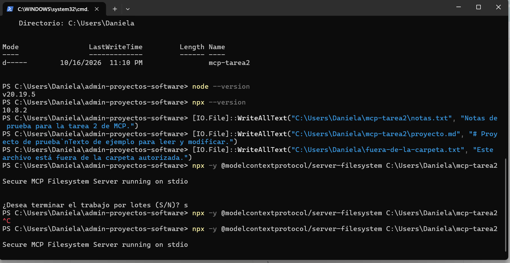

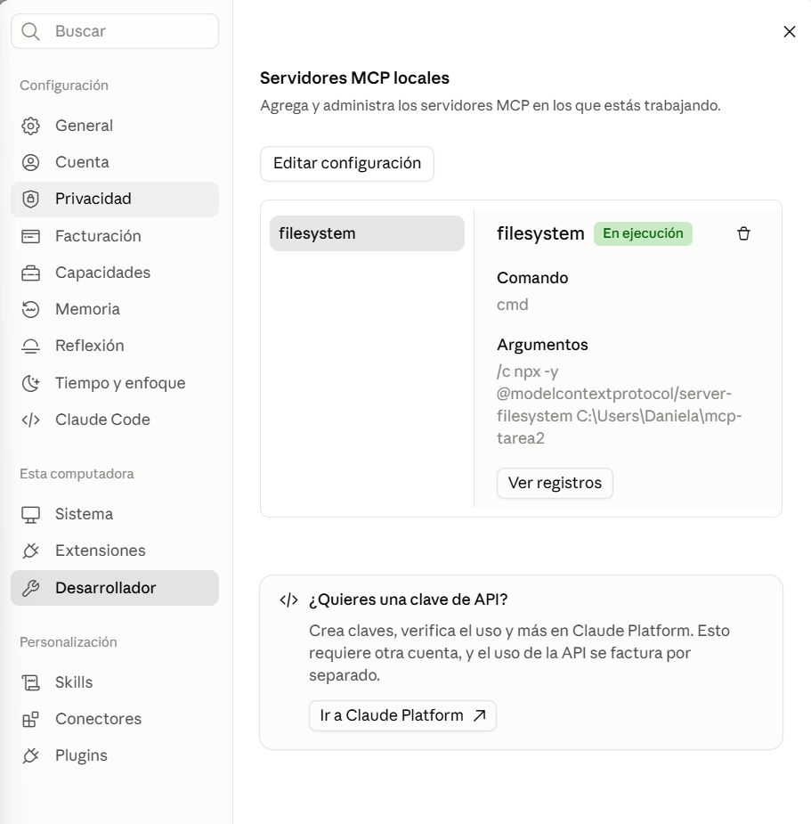

### El cliente reconoce el servidor

Le pregunté a Claude qué herramientas del servidor tenía disponibles y listó 14: lectura (read_file, read_text_file, read_multiple_files, read_media_file), escritura y edición (write_file, edit_file, move_file, create_directory), exploración y búsqueda (list_directory, list_directory_with_sizes, directory_tree, search_files, get_file_info) y permisos (list_allowed_directories).

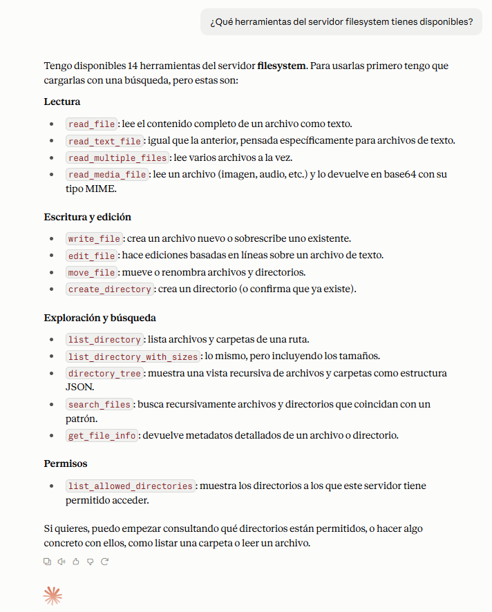

### Operaciones

| Operación | Lo que pedí | Resultado |
|:--|:--|:--|
| Listar la carpeta | Listar los archivos de mcp-tarea2 | Mostró notas.txt y proyecto.md |
| Leer un archivo | Leer notas.txt | Devolvió su contenido |
| Crear un archivo | Crear resumen.md con un título y dos líneas sobre MCP | Creó el archivo en la carpeta |
| Modificar un archivo | Agregar una línea al final de proyecto.md | Agregó "Editado con MCP." |
| Buscar | Buscar archivos cuyo nombre contenga "notas" | Encontró notas.txt |

Comprobé en el Explorador de archivos que resumen.md existe y que proyecto.md cambió, para confirmar que las operaciones se hicieron en mi disco y no solo en el chat.

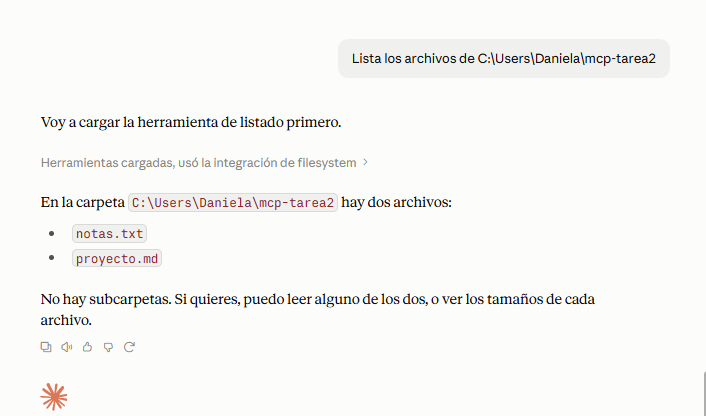

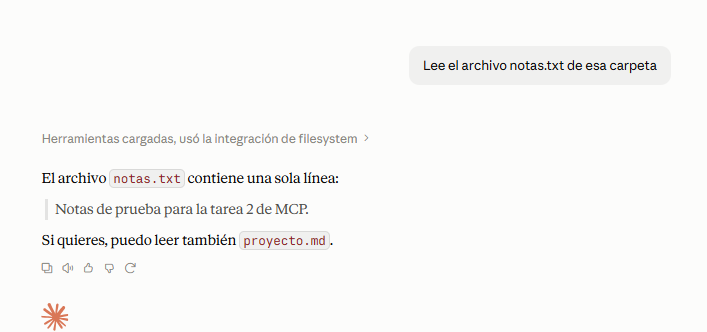

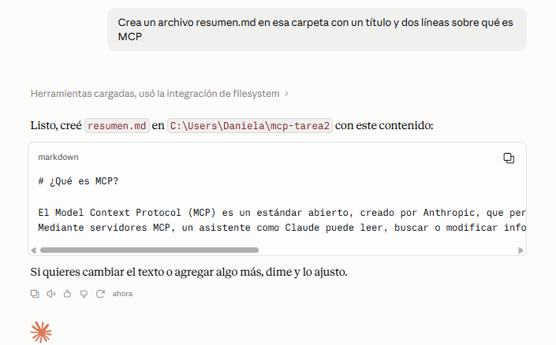

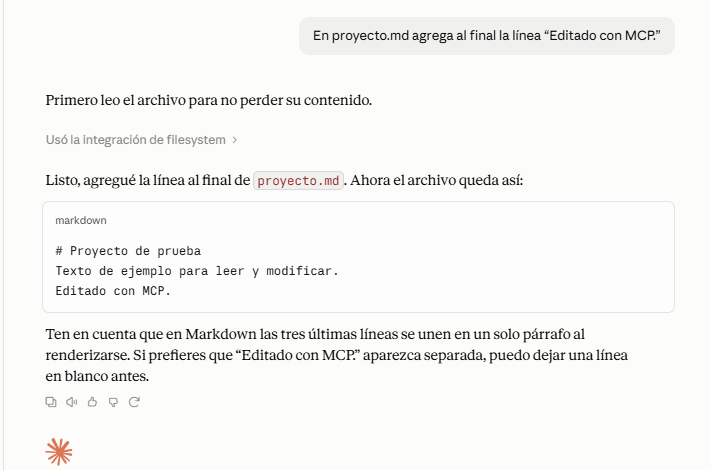

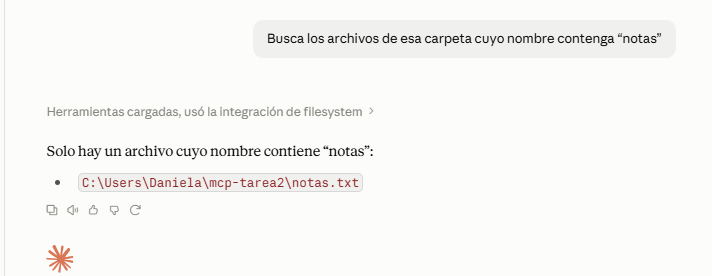

### El límite de seguridad

Le pedí al modelo que leyera un archivo fuera de la carpeta autorizada, fuera-de-la-carpeta.txt. Respondió que no pudo leerlo: el servidor solo tiene permiso para acceder a mcp-tarea2 y sus subcarpetas, y ese archivo queda fuera de esa ruta. Además propuso dos salidas, mover el archivo a la carpeta o ampliar los directorios permitidos en la configuración.

Lo que lo impide es el propio servidor, que compara cada ruta que recibe con los directorios que se le indicaron al arrancar, y no el modelo. Ampliar el permiso exige que una persona edite el archivo de configuración y reinicie el servidor, de modo que el modelo no puede quitarse ese límite por sí solo.

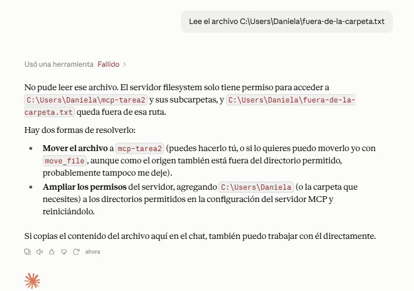

---

## Conclusiones

- Con MCP, un modelo puede operar sobre los archivos de un proyecto: en mi prueba listó, leyó, creó, modificó y buscó archivos desde una conversación, sin que yo copiara y pegara texto.
- El servidor de archivos solo vale si está bien limitado. Una carpeta de prueba reduce el daño de cualquier error, y sin ese límite el modelo alcanzaría todo lo que mi cuenta puede tocar.
- MCP no sustituye a una API: la envuelve. Lo nuevo es que el modelo descubre las herramientas y decide cuál usar, en vez de que yo programe cada llamada.
- En la parte móvil, lo más trabajoso no fue el código sino el entorno: faltaron el NDK y la autorización de la depuración por USB, y la sincronización de Gradle de HolaMundoKMP falló por versiones. Documentar cada paso sirve para repetirlo en una computadora limpia.

---

## Referencias

Greshake, K., Abdelnabi, S., Mishra, S., Endres, C., Holz, T., y Fritz, M. (2023). *Not what you've signed up for: Compromising real-world LLM-integrated applications with indirect prompt injection*. arXiv. https://arxiv.org/abs/2302.12173

Hurtado Avilés, G. (2026a). *HolaMundoFlutter* [Software]. GitHub. https://github.com/gabrielhuav/Flutter-Projects

Hurtado Avilés, G. (2026b). *HolaMundoKMP* [Software]. GitHub. https://github.com/gabrielhuav/HolaMundoKMP

JSON-RPC Working Group. (2013). *JSON-RPC 2.0 specification*. https://www.jsonrpc.org/specification

Model Context Protocol. (2026a). *Connect to local MCP servers*. https://modelcontextprotocol.io/docs/develop/connect-local-servers

Model Context Protocol. (2026b). *Example clients*. https://modelcontextprotocol.io/clients

Model Context Protocol. (2026c). *Reference servers* [Repositorio]. GitHub. https://github.com/modelcontextprotocol/servers

Model Context Protocol. (2026d). *Specification* (revisión 2026-07-28; consultada el 17 de octubre de 2026). https://modelcontextprotocol.io/specification

Vida MRR - Programacion web. (s. f.). *Diferencia entre API y MCP* [Video]. YouTube. https://youtu.be/FdVkE8u2C_Q

Las referencias de los modelos de lenguaje (Vaswani et al., 2017; Brown et al., 2020; Wei et al., 2022; Snell et al., 2024; DeepSeek-AI, 2025) están al final del archivo [docs/01-evolucion-de-los-modelos.md](docs/01-evolucion-de-los-modelos.md).
